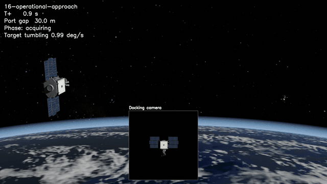
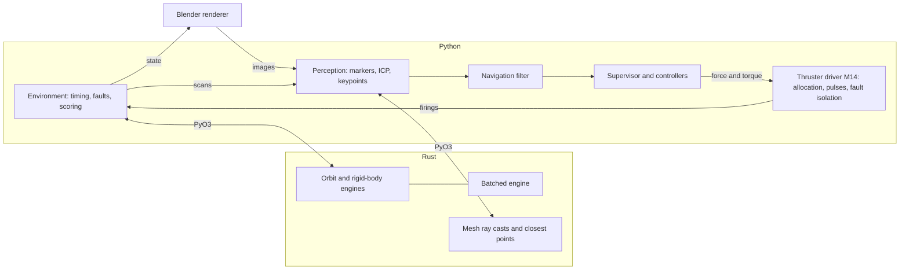

# RPOD

Simulation, perception and autonomy for spacecraft rendezvous, proximity operations and docking, on a Rust physics core.



*Episode 00 of the M14 suite, its last 2 m sped up 4–13×. A thruster pushing toward the target stuck on 12 m out and was isolated in 0.1 s (the amber banner). On its other 15 thrusters the chaser closes on QuikSCAT's docking port as the target tumbles at 0.9°/s, docks, and stops the tumble. Plumes show each nozzle's recorded firings; the inset is the docking lidar's depth image. `rpod showcase` rendered it from the run's saved record.*

A chaser spacecraft flies itself to a satellite and docks with it, using only what its sensors deliver: camera images that Blender renders from the simulated state, and a simulated flash lidar, arriving late and sometimes dropped or degraded. The hardest case is a dead, unmarked satellite tumbling freely. The chaser recognizes it by its shape, follows its rotating docking axis in, is captured, and stops the tumble. Physics runs in Rust. Guidance, navigation, perception and evaluation run in Python and never see the true state. Every result below comes from a frozen, hash-checked evaluation suite, a seeded Monte Carlo campaign or a recorded benchmark, and every run saves records that replay without rerunning the physics.

## Results

| Milestone | Adds | Result |
| --- | --- | --- |
| M1 | RK4 orbital engine in Rust, Python bindings, Rerun replay | 2 µm from the analytic orbit over 6,000 s; 8.2 million physics ticks/s |
| M2 | Rigid-body attitude, bounded force and torque, supervised truth-state approach | nominal, disturbed and retreat runs end inside their envelopes |
| M3 | Calibrated Blender camera, marker pose estimation | pose gates pass on held-out renders |
| M4 | Closed-loop approach on delayed image observations | all six qualification cases pass |
| M5 | Reusable `reset`/`step` environment, frozen 40-episode suite | 28/28 operational successes; aborts, dropped frames and lost tracking get their designed responses |
| M6 | Flash lidar fused in the same navigation filter | dropped frames and extended camera loss no longer force a brake |
| M7–M8 | Realistic scene: NASA's QuikSCAT, imaged Earth, space lighting, GPU rendering | 28/28; the camera accepted 8,420 of 8,432 images |
| M9 | Batched multithreaded engine, vectorized autonomy, validated navigation surrogate | 15.7 million environment ticks/s on 12 threads; 99.932% success over 100,000 episodes (95% interval 99.914–99.947%); agrees with Basilisk to 1.5e-8 m |
| M10 | Learned approach policy behind a runtime safety filter | same success rate as the reference, median completion 171 s instead of 210 s for 17% more Δv, no filter interventions; in the rendered suite, 28/28 operational successes 18% faster, and one abort ended in a false completion at the retreat tolerance |
| M11 | Unmarked, tumbling target: lidar shape matching and a keypoint network | lidar-only and camera-plus-lidar suites both pass every gate: 28/28 operational successes at the oracle's pace, both aborts retreated, target position error 1.2 cm median; the surrogate does not validate, so no population estimate |
| M12 | Lidar faults on the tumbling target, a collision-avoidance burn after a navigation loss, passive-safety coasts | fixes a mesh bug that had degraded M11's lidar matching (target error now 0.9 cm median); with M11's settings 6 of 12 lidar faults lose navigation and the burn keeps all six clear, while a more tolerant configuration recovers from all 12; a coasting chaser often hits the target from inside 12 m |
| M13 | Docking: a wide lidar on the docking axis, a committed final coast, a momentum-conserving capture latch and a detumble | all 28 episodes dock with the satellite tumbling at up to 1°/s: contact within 1.1 cm and 0.13° of the port (envelope 5 cm, 3°) at 0.039 m/s, then the joined stack detumbled in 11–20 s |
| M14 | 16 thrusters with hardware errors: least-propellant allocation by linear program, pulse modulation, and IMU likelihood-ratio detection of a stuck thruster | all 40 episodes dock, 28 nominal and 12 with a thruster stuck on or off mid-approach, at the hold or 1 m from contact: every failure isolated in 0.1 s with no false alarms, contact within 1.25 cm and 0.11°, 27–146 g of propellant |

28/28 is a fixed-suite result; population claims come from the Monte Carlo campaigns, which M11–M14 do not have. [REFERENCE.md](REFERENCE.md) records every gate, metric and caveat, and [benchmarks](benchmarks) holds the result files behind them.

## How it works



- **Rust core** (`crates/rpod-core`) owns physical state and the simulation clock: fixed-step RK4 for orbits and rigid bodies, atomic ticks, and a batch of independent environments stepped in parallel. Physics has no renderer dependency.
- **Python** (`src/rpod`) defines scenarios, sensors, perception, navigation, guidance, supervision and evaluation. Truth, observations and estimates stay separate: controllers see only delivered observations and their own estimates.
- **Blender** runs as a separate persistent worker that renders camera images from the states the feedback loop reaches. Rendering time never advances simulation time.
- **Records** hold configuration, seeds, software hashes, states, commands, observations, estimates and events, and replay in [Rerun](https://rerun.io) without rerunning physics.

## Quickstart

Needs [uv](https://docs.astral.sh/uv/) and stable Rust. Developed on Windows x86_64; CI also runs the tests on Ubuntu. From the repository root:

```bash
uv sync --locked
uv run --locked maturin develop --release --locked
uv run --no-sync python -m unittest discover -s tests

uv run --no-sync rpod run --scenario drift --output runs/drift
uv run --no-sync rpod replay runs/drift
uv run --no-sync rpod monte-carlo --episodes 10000 --output runs/campaign
```

Rendered experiments need Blender 5.2.3, at `.tools/blender-5.2.3-windows-x64/blender.exe` or on `PATH`. The realistic scene downloads NASA imagery and models (about 205 MB, hash-checked) on first use and is practical only on a CUDA GPU. [REFERENCE.md](REFERENCE.md#environment-and-commands) lists every command.

## Documentation

- [OVERVIEW.md](OVERVIEW.md): purpose, direction and open decisions.
- [REFERENCE.md](REFERENCE.md): the canonical specification of implemented behavior, interfaces and results.
- Milestone write-ups: [M9, batched engine and Monte Carlo](docs/m9-batched-engine.md), [M10, learned control](docs/m10-learned-control.md), [M11, tumbling target](docs/m11-tumbling-target.md), [M12, lidar faults](docs/m12-lidar-faults.md), [M13, docking](docs/m13-docking.md), [M14, thrusters](docs/m14-thrusters.md).

## Limitations

- M14 flies the docking on 16 thrusters; the other suites use ideal bounded force and torque. There are no plume effects on the target, and propellant use is reported but mass stays constant.
- There is no contact-dynamics model. M13 captures at contact with an envelope check and a momentum-conserving latch; the other suites end at a 5 m pre-contact hold.
- Perception is trained and tested on renders only; transfer to real imagery is untested.
- Reproducibility covers the same code, dependencies, build and platform. GPU rendering is not bitwise repeatable, so rendered reruns reproduce outcomes, not every pixel.

## License

Apache-2.0; see [LICENSE](LICENSE). [NOTICE](NOTICE) credits the NASA and ESA data downloaded at run time.
