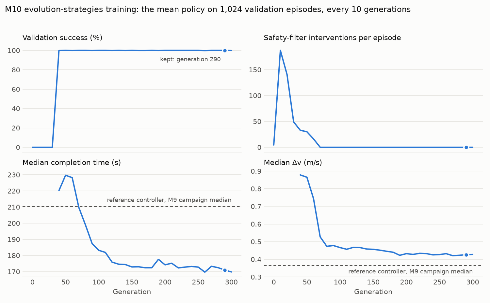

# M10: learned approach control behind a safety filter

The reference controller flies a hand-designed gap profile with a PD law. M10 asks whether a policy learned entirely in simulation, from noisy onboard estimates, can fly the same approach better, with a simple runtime check that keeps it inside a predefined safe envelope. The policy is trained in the M9 fleet against the M9 navigation surrogate, then judged in two places it never trained on: the paired 100,000-episode campaign and the frozen 40-episode rendered suite, where perception comes from rendered images.

[REFERENCE.md](../REFERENCE.md#learned-approach-control-m10) is the full specification.

## Method

**Hooks, then requalification.** Plugging in a new controller needed small hooks in five frozen evaluation files. They default to the code they replaced, so the M8 realistic suite was rerun on the new tree (`runs/m10-reference`) to show nothing changed; that run is also the learned controller's same-tree baseline.

**Policy.** A small NumPy network (13 inputs, two hidden layers of 64, 5,251 parameters) maps onboard estimates (the docking port's offset from the hold point, its velocity and the estimate's age) to a relative acceleration of at most 0.01 m/s² per axis. The known orbital terms (frame transport and the gravity difference) are added on top, as the reference law does.

**Safety filter.** Every control update predicts the port state 1 s ahead under the policy's command. If the prediction leaves the safe set, the reference law's hold at the current gap replaces the command for that period:

- closing speed within a braking envelope at half the chaser's thrust authority, and at most 0.3 m/s;
- lateral offset within 0.5 m + 0.1 × gap;
- gap no closer than 0.25 m inside the hold point.

The policy only flies the approach. Braking, retreat, acquisition and attitude stay with the reference supervisor, unchanged.

**Training.** OpenAI evolution strategies: each generation perturbs the policy 128 ways (64 antithetic pairs), flies every candidate on the same 16 fresh episodes with the same surrogate noise, ranks them and moves the policy with Adam. Success earns more for speed and less for Δv; failures are ranked by how far and how fast they ended from the hold point; each filter intervention costs a little. Every 10 generations the policy flies 1,024 validation episodes; the best is kept. Training, validation, campaign and suite seeds are all disjoint.



The policy first learned to finish (generation 40) while leaning on the filter, then learned not to need it (zero interventions from generation 70), then shortened the approach and cut its Δv. 300 generations took 110 minutes on a 6-core desktop.

## Results

**Paired campaign.** The M9 campaign's 100,000 episodes with the same surrogate noise, flown by each controller:

| Result | Reference | Learned |
| --- | --- | --- |
| Success | 99.932% (95% interval 99.914–99.947%) | 99.932% (99.914–99.947%) |
| Failures | 68 `navigation_lost` | the same 68 episodes, at the same ticks |
| Completion time | median 210.2 s, P99 228.6 s | median 171.2 s, P99 177.2 s |
| Δv | median 0.365 m/s | median 0.428 m/s |
| Closest port approach | 4.920 m | 4.966 m |
| Safety-filter interventions | — | 0 |
| True state outside the safe set | 0 ticks | 0 ticks |

Episode by episode, the learned controller is faster in every success (by 35.5–53.6 s) and spends more Δv in every one (median 0.061 m/s more): it trades fuel for time, as its training objective weighted them. The 68 failures are not the controller's: the surrogate's rejected images end the same episodes under either controller. Rerunning the reference campaign on the M10 tree reproduced M9's per-episode results exactly.

**Requalification.** The reference controller on the hooked tree passed the rendered suite's three gates with M8's 40 outcomes, durations and image counts. 18 episodes repeated M8's trajectories exactly; the other 22 first differ at a rendered image (GPU rendering is not bitwise repeatable) and end within 0.8 mm of M8.

**Rendered suite.** On the 40-episode realistic suite, the learned controller passed the operational and integrity gates and failed the fault gate.

| | Reference | Learned |
| --- | --- | --- |
| Operational | 28/28, median 210 s | 28/28, median 172 s, sooner by 36–60 s in every episode |
| Δv, operational median | 0.369 m/s | 0.425 m/s |
| Closest port approach | 4.949 m | 4.972 m |
| Aborts | 2/2 retreated | 1 retreated, 1 false completion |
| Dropped frames | success, overshooting to 4.46 m after braking | success, closest 4.98 m |
| Safety-filter interventions | — | 0 |

The false completion is in abort episode 29, and it is not the policy's doing.
- Both controllers' retreats run the same reference law, and both stop about 0.2 m short of the 30 m hold point. The camera's range estimate at that distance reads about 0.2 m long, and the physical check allows 0.2 m.
- The reference stayed just inside, at 0.17–0.19 m.
- The learned run's faster approach triggered the abort 29 s earlier, and it straddled the limit at 0.19–0.21 m. Its onboard dwell completed while the physical one did not.

The gate failure is reported rather than tuned away. It points at the retreat's completion margin rather than at the policy.

## Limitations

- **Trained and campaign-tested against the surrogate.** The policy never saw an image in training; the rendered suite is the only test of transfer to image-based navigation, and it is 40 episodes.
- **The filter's guarantee is on estimates.** It predicts the estimated state 1 s ahead with a double integrator; estimate error enters only through its margins. That the campaign never touched its envelope shows the trained policy stays well inside it, not that the filter would catch every unsafe command.
- **Only the approach is learned.** Braking, retreat, acquisition and attitude control are the reference law.
- **A time-for-fuel trade, not a dominance result.** The learned controller is faster and uses about 17% more Δv; a different fitness weighting would land elsewhere on that curve.

## Reproduce

```bash
uv run --no-sync rpod train-policy --output models/m10-policy.npy --generations 300
uv run --no-sync rpod monte-carlo --controller learned --episodes 100000 --seed 9 --output runs/m10-monte-carlo
uv run --no-sync rpod m5-suite --scene realistic --calibration datasets/m8-vbar/calibration.json --output runs/m10-reference --label m10-reference
uv run --no-sync rpod m5-suite --scene realistic --calibration datasets/m8-vbar/calibration.json --controller learned --output runs/m10-learned --label m10-learned
```

Training and the campaign need only the tracked surrogate (`models/m9-surrogate.json`); the rendered suites need Blender and the M8 calibration.
