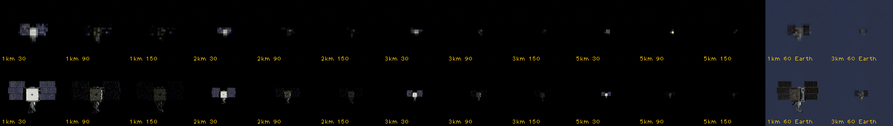

# M15: far-range rendezvous, stage 0

Every episode so far starts with the chaser already 30 m from the target. M15 will start it kilometres behind, on the same orbit, and bring it to that 30 m hold point. On the way it navigates by camera bearings alone: the direction to the target, without its distance or attitude. Stage 0 measured the unknowns that decide how to build that, before building any of it. [REFERENCE.md](../REFERENCE.md#far-range-rendezvous-m15-stage-0) has the specification, and [benchmarks/m15-stage0.json](../benchmarks/m15-stage0.json) the numbers.

## Physics: keep the 0.1 s tick, call the engine in blocks

A far-range approach takes hours. The test case is a 3 h coast that starts 3 km behind the target and 300 m below it, about two orbits, over which the chaser drifts 5.5 km relative to the target.

- **Cost:** the Rust engine runs those 108,000 ticks of 0.1 s in 0.05 s when called once for all of them, and in 0.22 s when called once per tick. Physics is never the bottleneck.
- **Accuracy:** an independent high-precision integrator puts the relative position after 3 h within 3 µm at the 0.1 s tick, 1 µm at 1 s and 15 µm at 10 s. A coarser tick would save nothing worth having.
- **Decision:** far range keeps the docking's 0.1 s tick, so the handover at the hold point needs no change of step. The loop calls the engine once per 1 s control update, for 10 ticks.

## Pointing: a 1 Hz loop keeps the camera on the target

The chaser has to keep its camera on a target whose direction changes as it drifts past.

- A simple attitude law at 1 Hz, with the M2 gains and the true direction to the target, turns the camera onto the target from 5.8° off within a minute. It then holds it within 0.02° (median) and 0.48° (worst). The worst came 4 s after the closest approach, 303 m under the target, where the direction to it turns fastest.
- It costs 0.25 ms of Python per update, 2.7 s for a 3 h episode.

## The Sun and Earth's shadow

Until now the Sun was placed relative to the chaser's starting attitude, and it was only guaranteed to stay above Earth's limb for 600 s. An M7 episode that reached sunset failed a gate. An approach lasting hours will pass through Earth's shadow.

- **New model** (`rendezvous.py`): the Sun is a fixed direction in space, set by its elevation above the orbit plane (beta) and its longitude within it. How much of the Sun is visible comes from a conical shadow, with the same 0.53° Sun disk the renderer draws, and so the same penumbra.
- **Shadow per orbit** (the 400 km orbit takes 5,554 s): 2,166 s at beta 0°, 39% of the orbit; 2,067 s at 30°; 1,462 s at 60°; none beyond 70.2°. Crossing the penumbra takes 8 s at beta 0° and 21 s at 60°. These match the textbook cylindrical shadow within 0.03 s.
- **Blender casts the same shadow.** Rendered at 256 samples per pixel as the Sun sets behind Earth's limb, the target's brightness follows the model's visible fraction within 0.004 at every step through the penumbra.
- **Consequence:** at low beta the camera loses the target for 36 minutes of every 93-minute orbit. Stage 1 has to plan the approach around eclipses, or pick a season with high beta.

## Records: M15 needs its own

The schema-3 record that every episode so far writes, and the loader that checks it, can't hold a bearings-only run without changing their checks:
- an accepted observation must be a full pose, a rotation and a position in front of the camera, but a bearing has neither range nor attitude;
- every saved estimate of the target must be the 12-state filter (position, velocity, attitude and rate, with a 12×12 covariance) and must cite an accepted pose, but far range estimates only the target's position and velocity, from bearings;
- an estimate's health is set by its age, "lost" after 3 s, but far-range bearings come seconds apart and stop for 36 minutes in eclipse;
- the runner overwrites the episode's Sun with the old rule and records the 12-state filter's configuration;
- it saves every 0.1 s tick in full: for a 3 h episode about 56 MB of states and, with a 12×12 covariance on every tick, about 400 MB of estimates.

**Decision:** M15 gets its own runner and record format, with its own loader. It reuses the engine, the camera, the renderer and the image records. The existing format stays as it is, so no earlier record changes.

## Cameras: a narrow one needs no new Blender code

The plan expected a new Blender worker for a narrow camera. None is needed: the camera's field of view already reaches Blender's lens. Each camera does need its own Blender process, since a renderer holds one camera.

The detectability renders show the unmarked QuikSCAT, wings stowed, holding its attitude, from 1, 2, 3 and 5 km behind. The Sun is 30°, 90° or 150° from the camera direction (150° lights it from behind). The images get the suites' sensor noise (2 grey levels) and blur.



| Against space | 1 km | 2 km | 3 km | 5 km |
| --- | --- | --- | --- | --- |
| Wide camera (35°): pixels the target lights | 26–92 | 7–27 | 4–16 | 2–7 |
| Wide camera: signal-to-noise ratio | 19–97 | 15–80 | 11–64 | 9–73 |
| Narrow camera (5°): pixels the target lights | 1,220–3,617 | 310–965 | 141–456 | 53–182 |
| Narrow camera: signal-to-noise ratio | 39–119 | 29–118 | 24–113 | 20–106 |

Each cell spans the three Sun angles. A pixel counts when the target changes it by more than three times the noise; the signal-to-noise ratio is the target's brightest pixel, after the blur, over the noise.

- **Against space** the target was found in every case, by a simple detector that thresholds the whole image and keeps its brightest blob. The hardest case is the wide camera at 5 km, lit from behind: 2 pixels at a signal-to-noise ratio of 9.
- **The bearing error** is the distance from the centre of the target's light to its centre of mass. Uneven lighting pulls the light off-centre: at worst 0.58 mrad with the wide camera and 0.26 mrad with the narrow one, or 1.7 m and 0.27 m at the ranges tested.
- **Against Earth** (the chaser above the target's orbit, looking 30° down past it), the target is a faint shape on a bright, textured background, and the simple detector failed in all four cases.
- **A frame takes 0.34 s** to render with the target against space, so one bearing a second for 3 h costs about an hour of GPU time per episode.

**For stage 1:**
- **Field of view:** the wide camera already found the target against space in every case. A narrow one adds margin at 5 km and cuts the bearing error by more than half. Stage 1 chooses the field of view, of which only 5° was tried here, and the bearing rate within the GPU budget.
- **Line of sight:** against Earth the simple detector failed. Stage 1 therefore starts from a constraint it still has to confirm: keep the line of sight above Earth's limb, which lies 20° below the horizontal at 400 km, so the chaser stays no higher above the target than about a third of the range. Only a 30° look-down was rendered; between 0° and 30° is untested.

## Limitations

- Pointing used the true direction to the target, not an estimate. With bearings-only estimates the error will be larger.
- The renderer draws no stars, Sun glare or stray light, so a sunlit target on black space is nearly always found by a threshold. At the 150° Sun angle the Sun sits 30° off the camera's axis with no penalty here.
- One target attitude was rendered, holding steady relative to its orbit with the wings stowed.
- The records finding comes from reading the loader and the runner, not from a run.
- The two cameras' Blender processes ran one after the other; two at once on the 6 GB card is unmeasured. Starting one takes 2.3–2.5 s, so switching cameras at the handover is cheap.
- One far-range coast and one narrow field of view were measured.

## Reproduce

```bash
uv run --no-sync rpod m15-stage0 --output runs/m15-stage0
```

`--no-renders` skips the GPU part and takes about 11 s on the CPU.
